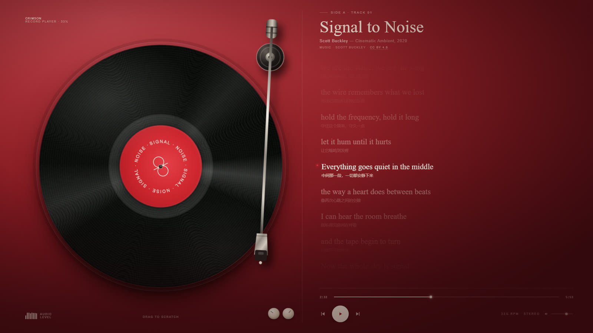
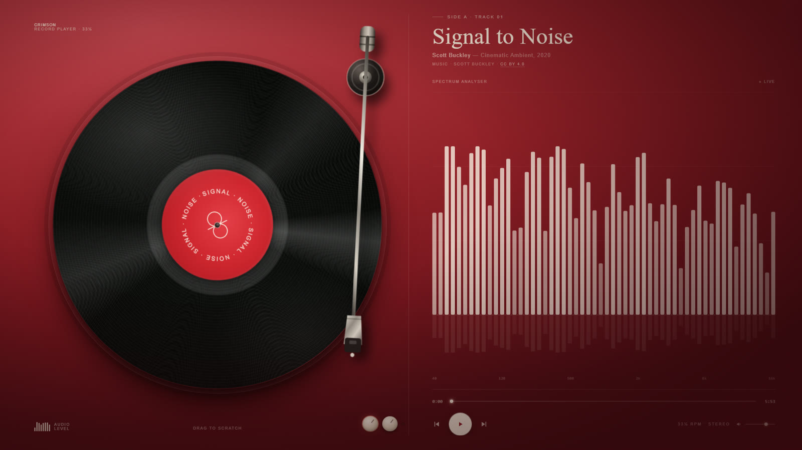
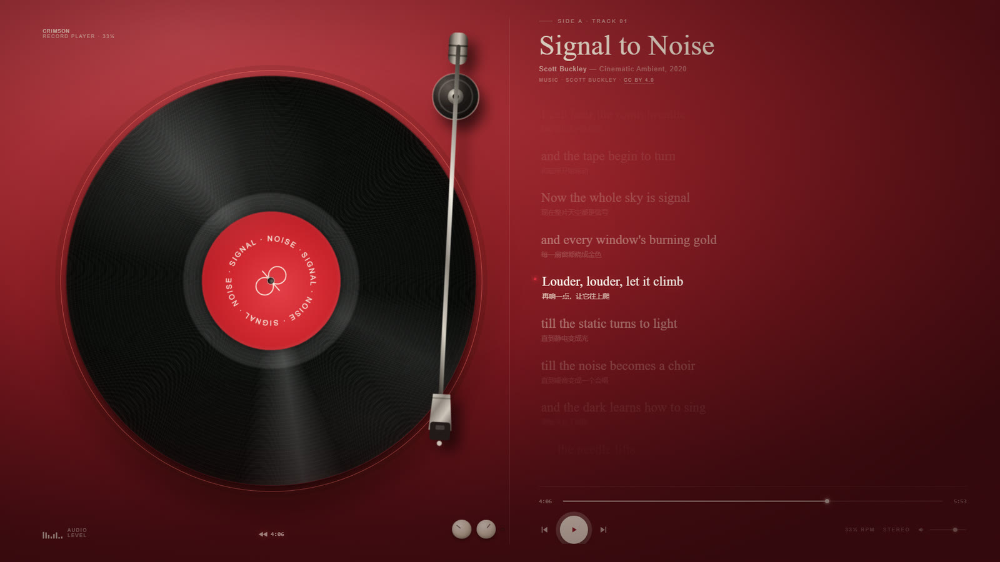

# Vinyl Player · 黑胶唱片播放器

> A single-file vinyl record player UI — spinning disc, drag-to-scratch, synced lyrics and a live spectrum analyser.

一个横屏音乐播放界面：左侧旋转黑胶 + 唱臂，右侧歌词。按住唱片可以直接搓碟，松手有惯性；歌词与实时频谱两种视图一键切换。

**在线试听 → https://zxxy326.github.io/vinyl-player/**
**下载 Windows / Android 版 → https://github.com/Zxxy326/vinyl-player/releases**



## 特性

- **可转的黑胶**：播放时匀速旋转，暂停即停；暂停时唱臂抬起，播放时 1.5s 缓动落针
- **拖拽搓碟**：按住唱片拖动，唱片跟手转、音轨跟着刮、松手带惯性；几乎没动则视为点击播放/暂停
- **双视图**：歌词 ⇄ 实时频谱，机身右下角左侧那颗旋钮切换；有歌词默认歌词，没歌词自动显示频谱
- **可换的背景色板**：6 套同风格的绒布光预设（绯红 / 琥珀 / 松绿 / 藏蓝 / 紫罗兰 / 石墨）+ 自定义色相条；背景、暗部、启动幕和唱片中心标一起换，选择存在本机
- **真频谱**：Web Audio `AnalyserNode` + 56 根对数分频柱，不是假动画
- **曲库抽屉**：歌曲 / 专辑 / 艺术家 / 歌单 / 设置五个页签；专辑与艺术家按曲目聚合，歌单支持新建、加入、从歌单直接播放
- **音质分级**：按采样率、位深、码率自动标 SQ（无损）/ HQ / Hi-Res / 其他徽标
- **听歌统计**：记住每首歌的播放次数、累计时长，汇总成「今天 / 最近 7 天 / 全部」，全部存在本机
- **音乐库统计**：总曲目、总大小、总时长与各音质档位占比，一盘一眼看清
- **完整控制**：进度条拖拽、点歌词跳转、上一句/下一句、空格暂停、← → 快进 5 秒、音量滑块与机身旋钮联动
- **曲库搜索**：标题 / 艺人 / 专辑 / 音质格式即时过滤，回车播第一首，`/` 直接从任何地方聚焦搜索框
- **通知栏切歌**：安卓的媒体卡片（各厂商胶囊、锁屏、蓝牙、耳机线控）共用一条 MediaStyle 通知，上一首 / 播放暂停 / 下一首都在
- **内嵌封面与歌词**：安卓端直接从音频文件里读 APIC / FLAC PICTURE 与 USLT / Vorbis Comment / `©lyr`，不再依赖系统相册缓存
- **零依赖**：一个 HTML + 一个音频文件，双击即开



搓碟时唱片外圈亮起红色光环，底部读数实时显示刮擦位置：



## 运行

三种形态，同一套界面代码：

| 形态 | 怎么用 | 曲库 |
| --- | --- | --- |
| **网页单文件** | 双击 `index.html`，或 `python -m http.server 8000` | 拖入文件夹（`webkitdirectory`） |
| **Windows 桌面版** | 到 [Releases](https://github.com/Zxxy326/vinyl-player/releases) 下载 `vinyl-player.exe` 直接双击（免安装），或装 `Vinyl Player_*_x64-setup.exe` | 原生扫描目录，读 ID3/FLAC/Vorbis 标签与内嵌封面、内嵌歌词 |
| **Android** | 到 [Releases](https://github.com/Zxxy326/vinyl-player/releases) 下载 `vinyl-player-*.apk` 安装（Android 7.0+） | 系统媒体库（MediaStore）自动扫描，无需选目录 |

桌面版是**绿色单文件**，不写注册表、不装运行库（Win10/11 自带 WebView2）。NSIS 安装包由 CI 在 GitHub Actions 上额外产出，本地打包见下方「从源码构建」。

推荐网页版也用本地服务打开：`file://` 协议下浏览器可能因跨源隔离拿不到频谱数据，界面会自动降级为程序化波形；通过 http 访问则是真实频谱。

## 桌面版与安卓版

两端共用 `src/` 里的同一份界面与交互逻辑，只有「取音频数据」这一层分叉：

```
src/core/platform.js   平台探测、选目录、读歌词/封面
src/audio/backend.js   AudioBackend 统一接口（load/play/seek/pull/bins…）
src/audio/webaudio.js  桌面：Web Audio AnalyserNode
src/audio/media3.js    安卓：Media3 + 原生 PCM 抓取
```

- **桌面**（Tauri 2 + WebView2）：Rust 侧负责扫描目录、读标签、找同名 `.lrc`；遇到 WMA / APE 这类 WebView 解不了的格式，优先调 `ffmpeg` 转 FLAC，没有 `ffmpeg` 则用 `symphonia` 自行解码成 WAV，缓存到 `%LOCALAPPDATA%\vinyl-player\cache`（LRU 上限 2 GB）。**`ffmpeg` 是可选的**，放到 exe 同目录或加进 PATH 即可启用。
- **安卓**（原生 Kotlin 壳 + Media3/ExoPlayer）：`WebView` 加载同一份 `dist/`，通过 `@JavascriptInterface` 暴露 `window.AndroidPlayer`；音频由 `MediaSessionService` 在原生层播放，通知栏/锁屏控制直接可用。
- **安卓频谱**：没有 `Visualizer`（需要 `RECORD_AUDIO` 且各机型行为不一），改用 `TeeAudioProcessor` 在音频管线里旁路抓 PCM，Kotlin 自写 radix-2 FFT + Hann 窗，输出与桌面 `AnalyserNode` 完全同构的 56 个对数 bin。
- **安卓搓碟**：`PlaybackParameters(speed, pitch)` 且 **`pitch` 必须等于 `speed`** 才是变速变调（真·搓碟）；seek 用 42 ms 限流提交，避免高频 seek 卡住解码器。
- **版式**：横屏两栏（唱片 + 歌词），竖屏单屏不滚动（唱片在上、歌词居中、传输栏贴底），靠 `@media (orientation: …)` 切换。
- **曲库记忆**：上次选的目录存本机，重开自动重扫；目录失效会静默清掉并回到空状态，不会卡在报错。

## 循环与随机怎么叠

两个按钮各自独立，同时打开时的行为由下表决定——按下时会弹一条 toast 把当前语义说清楚，不用猜：

| 循环 \ 随机 | 关 | 开（先洗成一副牌再顺着走） |
| --- | --- | --- |
| **列表循环**（默认，无徽标） | 最后一首播完回到第一首 | 一副牌走完重新洗牌，永不停 |
| **单曲循环**（右上角红色「1」） | 当前这首反复播 | **当前这首反复播**（随机只管「换哪首」，单曲循环始终优先） |
| **不循环**（无徽标，点两次） | 播到最后一首就停 | 这副牌走完就停，不再重新洗牌 |

随机不是「每次随机取一个下标」，而是先 `shuffle` 出一副顺序再顺着指针走——否则「上一首」会跳到你没听过的那首、不循环时也永远停不下来。切歌、换曲库、开关随机都会重建这副牌。
- **断点续播**：曲目进度与上次播放的曲目 id 存 `localStorage`，重开自动回到原位。

两端都**不申请网络权限**，纯本地播放。

## 从源码构建

```bash
npm install --registry=https://registry.npmmirror.com

npm run build          # 把 src/ 拼成单文件 index.html + dist/ + android assets
npm run dev            # 本地起服务预览（http://localhost:8000）

npm run desktop:build  # 出 Windows exe + NSIS 安装包
npm run android:build  # 出 APK（需 JDK 17 + Android SDK 35）
```

`index.html` 是**构建产物，不要手改**——它由 `scripts/build-web.mjs` 按拓扑序拼接 `src/` 下的 ES 模块并内联 CSS 生成，CI 会校验它与源码是否同步。改代码请改 `src/`。

首次跑 `desktop:build` 时 Tauri 会联网下载 NSIS 打包工具链；网络受限的环境可以直接 `tauri build --no-bundle`，只产 `src-tauri/target/release/vinyl-player.exe`（绿色版，功能完整）。安卓签名密钥放 `android/keystore/vinyl-player.jks`，或用 `VP_KEYSTORE` / `VP_STORE_PASS` / `VP_KEY_ALIAS` / `VP_KEY_PASS` 四个环境变量指定。

## 项目结构

```
src/                       # 源码（16 个 ES 模块 + 6 个样式表）
  index.html               # 模板，含 /*__STYLES__*/ 与 /*__SCRIPT__*/ 占位
  styles/                  # base / deck / panel / app / chrome / boot
  core/                    # 工具、状态与持久化、平台桥、平台能力
  audio/                   # 后端抽象 + WebAudio + Media3 两套实现
  lyrics/lrc.js            # LRC 解析（offset、一行多时间戳、[mm:ss:xx]）
  ui/                      # 唱片、歌词、频谱、传输栏、曲库抽屉、性能降级
  data/demo.js             # 内置演示曲目与内页文字
src-tauri/                 # Windows 桌面壳（Rust）
  src/scan.rs              # 目录扫描、标签、同名 .lrc
  src/transcode.rs         # ffmpeg / symphonia 兜底转码 + LRU 缓存
android/                   # Android 壳（Kotlin + Media3）
  app/src/main/java/...    # WebView、JavascriptInterface、MediaSessionService、FFT
scripts/build-web.mjs      # 零依赖打包器
dist/                      # 构建产物（Tauri 前端目录）
index.html                 # 构建产物（网页版单文件，双击即开）
```

`index.html` 内部按块注释分区：

| 区块 | 内容 |
| --- | --- |
| 基础 / 布局 | 配色变量、绒布噪点背景、两栏网格、安全区变量 |
| 左：唱机 | 唱片旋转、纹路与高光、中心红标、唱臂 SVG |
| 右：歌词面板 | 歌词滚动、进度条、控件、频谱画布 |
| 脚本 | 歌词解析、音频后端、唱片角度与播放循环、搓碟、双视图、曲库 |

## 换成你自己的歌

网页版演示曲目写在 `src/data/demo.js`，改完重新 `npm run build`：

1. 把音频放进 `assets/`，改 `demo.js` 里的 `src`
2. 改 `DEMO_LYRICS`（`t` 是秒；留空数组则自动切到频谱视图，切换按钮置灰）
3. 改标题、艺人、署名
4. 想调手感：`src/ui/disc.js` 顶部两个常量
   ```js
   const SPIN_PERIOD = 22;   // 视觉转速：22 秒一圈
   const SEC_PER_TURN = 6;   // 搓碟换算：手转一圈 = 音轨前后 6 秒
   ```

**桌面版和安卓版不需要改代码**：直接用界面里的「选文件夹 / 曲库」按钮扫本地目录，标签和同名 `.lrc` 会自动读出来。

歌词时间轴建议对着音频排，而不是平均分。可以用 ffmpeg 导一遍响度包络找段落：

```bash
ffmpeg -i track.mp3 -af "aresample=8000,asetnsamples=32000,astats=metadata=1:reset=1,\
ametadata=print:key=lavfi.astats.Overall.RMS_level:file=-" -f null - 2>/dev/null
```

## 实现要点

几个踩过的坑，写在代码注释里，也记在这里：

- **唱片旋转不能用 CSS animation**：拖拽接管后再松手，动画会从 `0deg` 重来，画面会跳。改成 JS 角度变量在 rAF 里累加，拖拽 / 惯性 / 正常播放三种状态才能无缝衔接。
- **搓碟要出声，就不能在拖拽时 pause**：保持音源运行、每次 `pointermove` 写一次 `audio.currentTime`，高频 seek 本身就是刮擦声；松手再写一次消除漂移。
- **`AudioContext` 必须在用户手势里创建**：`createMediaElementSource` 会把 audio 的输出重定向进音频图，若 context 处于挂起状态，结果就是全程静音。所以只在播放键 / 按住唱片 / 空格 / 切换旋钮这些手势里创建，自动播放那条路径不碰它。
- **频谱兜底要能恢复**：连续 2 秒全零频段才判定"取不到数据"转程序化波形，且一旦取到就切回——否则乐曲里正常的安静段落会把可视化永久打成假的。
- **安卓不要用 `Visualizer`**：Android 9+ 抓输出混音要 `RECORD_AUDIO`，部分 OEM 直接返回全零。改用 `TeeAudioProcessor` 在音频管线里旁路拿 PCM，权限干净、数据可靠。
- **搓碟的变调必须走 Sonic**：`DefaultAudioSink` 要显式 `setEnableAudioTrackPlaybackParams(false)`。开着它 `setPlaybackSpeed` 会用 AudioTrack 原生时间伸缩——只变速、不变调，黑胶的转速手感就没了。
- **media3 1.4 起 `ExoPlayer.Builder` 没有 `setAudioSink`**：只能自定义 `DefaultRenderersFactory` 并 override `buildAudioSink()`。另外 `TeeAudioProcessor` / `SilenceSkippingAudioProcessor` 在 `androidx.media3.exoplayer.audio` 包下，不在 `common.audio`。
- **ffmpeg 输出临时文件必须带真扩展名**：写成 `xxx.flac.part` 会让它无法推断 muxer 直接报错，得用 `xxx.part.flac` 或显式 `-f flac`。
- **不要把 media3 的 `DefaultMediaNotificationProvider` 当默认选项**：`MediaNotificationManager.updateNotification()` 会先要求「服务内部有一个已连上的 `MediaController`、timeline 非空、状态不是 IDLE」，全满足才发通知。本项目的播放指令是 WebView 直接打给 ExoPlayer 的，服务端根本没有控制器，于是 `onUpdateNotification()` 每次都静默 return，通知栏永远空白且不报错。改成自己拼 `Notification.MediaStyle` + `session.platformToken` 后一切正常，锁屏/胶囊/蓝牙仍走同一个 session。
- **`inset:0` 是 Chrome 87 才有的简写**：安卓 WebView 的版本跟着系统走，老机型可能低于 87，此时 `position:absolute;inset:0` 的四边全是 `auto`，绝对定位元素的宽度会塌成 0——唱片、纹路、封面整块消失，页面只剩底色。统一改写成 `top/right/bottom/left`。
- **给 WebView 加 padding 不生效**：WebView 会忽略自身的 padding 照旧铺满，必须在外面套一层 `FrameLayout`，把系统栏 inset 加到容器上，内容区才会真的缩下来。
- **`setDecorFitsSystemWindows(window,false)` 要在 `setContentView` 之前调**：晚一步 AppCompat 的根布局已经把 inset 消费掉了，之后再装 `OnApplyWindowInsetsListener` 也等不到回调。
- **ID3 的 USLT 常用单个 `\r` 换行**：只按 `\r\n` 归一化会把整首歌词糊成一行，`split(/\r\n?|\n/)` 才稳。

## 音频

演示曲目 **Signal to Noise — Scott Buckley**，以 [CC BY 4.0](https://creativecommons.org/licenses/by/4.0/) 授权使用，可商用、可修改，需署名。

- 艺术家：https://www.scottbuckley.com.au/
- 原曲页面：https://www.scottbuckley.com.au/library/signal-to-noise/
- 仓库内为 160 kbps 转码版本（原始 320 kbps）

这首是器乐曲，没有唱词，所以右侧显示的是随音乐滚动的**唱片内页文字**（本项目原创撰写，时间轴按乐曲段落排布）。换上你自己的有词曲目后，`LYRICS` 填歌词即可。

## 请作者喝杯咖啡

Vinyl Player 完全免费，没有广告，也没有内购，曲库和歌词都在本机处理。
如果它帮你省下了一个音乐会员，或者只是让你听歌时心情好了一点，欢迎请作者喝杯咖啡。

<p align="center">
  
</p>

## License

代码以 [MIT](LICENSE) 授权。音频为 CC BY 4.0，版权归 Scott Buckley，不在 MIT 覆盖范围内，详见 [LICENSE](LICENSE) 末尾说明。

---

<sub>Interface inspired by a crimson record-player still. Built as a single HTML file, no build step, no dependencies.</sub>
