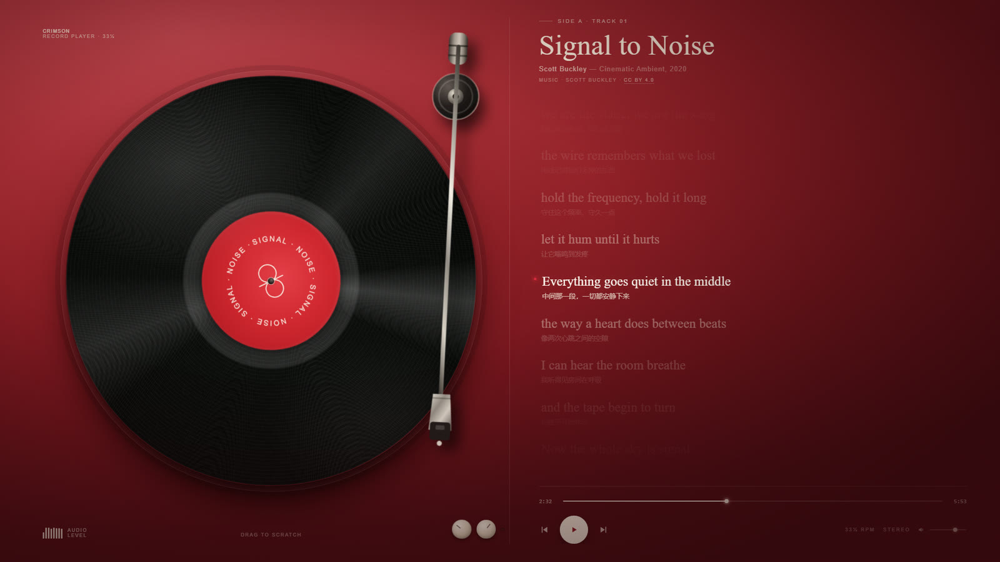
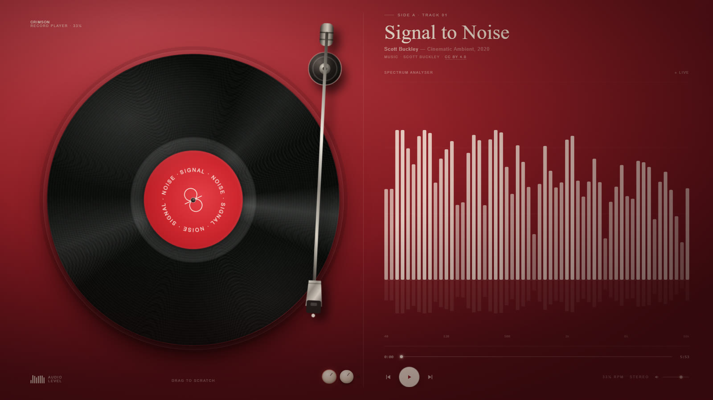
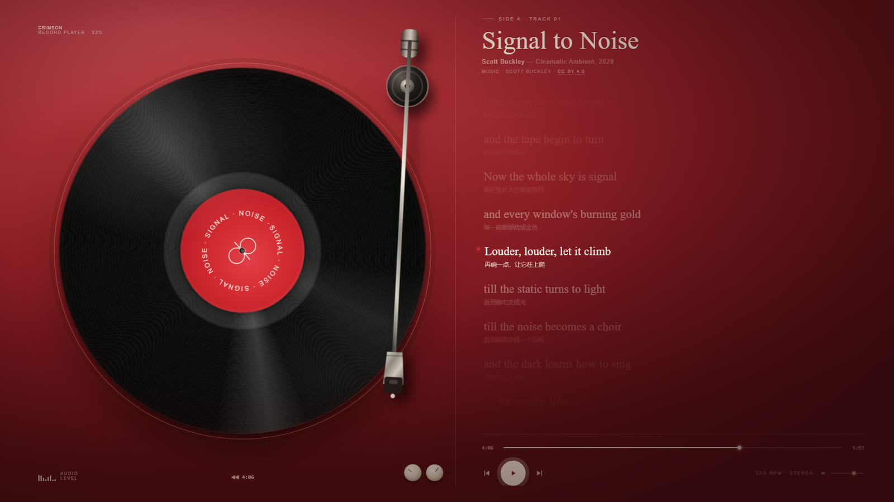

# Vinyl Player · 黑胶唱片播放器

> A single-file vinyl record player UI — spinning disc, drag-to-scratch, synced lyrics and a live spectrum analyser.

一个横屏音乐播放界面：左侧旋转黑胶 + 唱臂，右侧歌词。按住唱片可以直接搓碟，松手有惯性；歌词与实时频谱两种视图一键切换。

**在线试听 → https://zxxy326.github.io/vinyl-player/**



## 特性

- **可转的黑胶**：播放时匀速旋转，暂停即停；暂停时唱臂抬起，播放时 1.5s 缓动落针
- **拖拽搓碟**：按住唱片拖动，唱片跟手转、音轨跟着刮、松手带惯性；几乎没动则视为点击播放/暂停
- **双视图**：歌词 ⇄ 实时频谱，机身右下角左侧那颗旋钮切换；有歌词默认歌词，没歌词自动显示频谱
- **真频谱**：Web Audio `AnalyserNode` + 56 根对数分频柱，不是假动画
- **完整控制**：进度条拖拽、点歌词跳转、上一句/下一句、空格暂停、← → 快进 5 秒、音量滑块与机身旋钮联动
- **零依赖**：一个 HTML + 一个音频文件，双击即开



搓碟时唱片外圈亮起红色光环，底部读数实时显示刮擦位置：



## 运行

```bash
# 方式一：直接双击 index.html

# 方式二（推荐）：起个本地服务
python -m http.server 8000
# 打开 http://localhost:8000
```

推荐用本地服务打开：`file://` 协议下浏览器可能因跨源隔离拿不到频谱数据，界面会自动降级为程序化波形；通过 http 访问则是真实频谱。

## 项目结构

```
index.html                     # 全部结构 / 样式 / 逻辑，单文件
assets/signal-to-noise-160.mp3 # 演示音频（CC BY 4.0，见下方「音频」）
docs/                          # README 截图
```

`index.html` 内部按块注释分区：

| 区块 | 内容 |
| --- | --- |
| 基础 / 布局 | 配色变量、绒布噪点背景、两栏网格 |
| 左：唱机 | 唱片旋转、纹路与高光、中心红标、唱臂 SVG |
| 右：歌词面板 | 歌词滚动、进度条、控件、频谱画布 |
| 脚本 | 歌词数据、音频 ⇄ 界面、唱片角度与播放循环、搓碟、双视图 |

## 换成你自己的歌

1. 把音频放进 `assets/`，改 `<audio src="...">`
2. 改 `LYRICS` 数组（`t` 是秒）和 `DURATION`（默认会被音频元数据覆盖，可不填）
3. 改标题、艺人、`.credit` 里的署名
4. **没有歌词**：把 `LYRICS` 清空即可，界面会自动切到频谱视图，切换按钮自动置灰
5. 想调手感：脚本顶部两个常量
   ```js
   const SPIN_PERIOD = 22;   // 视觉转速：22 秒一圈
   const SEC_PER_TURN = 6;   // 搓碟换算：手转一圈 = 音轨前后 6 秒
   ```

歌词时间轴建议对着音频排，而不是平均分。可以用 ffmpeg 导一遍响度包络找段落：

```bash
ffmpeg -i track.mp3 -af "aresample=8000,asetnsamples=32000,astats=metadata=1:reset=1,\
ametadata=print:key=lavfi.astats.Overall.RMS_level:file=-" -f null - 2>/dev/null
```

## 实现要点

几个踩过的坑，写在代码注释里，也记在这里：

- **唱片旋转不能用 CSS animation**：拖拽接管后再松手，动画会从 `0deg` 重来，画面会跳。改成 JS 角度变量在 rAF 里累加，拖拽 / 惯性 / 正常播放三种状态才能无缝衔接。
- **搓碟要出声，就不能在拖拽时 pause**：保持音源运行、每次 `pointermove` 写一次 `audio.currentTime`，高频 seek 本身就是刮擦声；松手再写一次消除漂移。
- **`AudioContext` 必须在用户手势里创建**：`createMediaElementSource` 会把 audio 的输出重定向进音频图，若 context 处于挂起状态，结果就是全程静音。所以只在播放键 / 按住唱片 / 空格 / 切换旋钮这些手势里创建，自动播放那条路径不碰它。
- **频谱兜底要能恢复**：连续 2 秒全零频段才判定"取不到数据"转程序化波形，且一旦取到就切回——否则乐曲里正常的安静段落会把可视化永久打成假的。

## 音频

演示曲目 **Signal to Noise — Scott Buckley**，以 [CC BY 4.0](https://creativecommons.org/licenses/by/4.0/) 授权使用，可商用、可修改，需署名。

- 艺术家：https://www.scottbuckley.com.au/
- 原曲页面：https://www.scottbuckley.com.au/library/signal-to-noise/
- 仓库内为 160 kbps 转码版本（原始 320 kbps）

这首是器乐曲，没有唱词，所以右侧显示的是随音乐滚动的**唱片内页文字**（本项目原创撰写，时间轴按乐曲段落排布）。换上你自己的有词曲目后，`LYRICS` 填歌词即可。

## License

代码以 [MIT](LICENSE) 授权。音频为 CC BY 4.0，版权归 Scott Buckley，不在 MIT 覆盖范围内，详见 [LICENSE](LICENSE) 末尾说明。

---

<sub>Interface inspired by a crimson record-player still. Built as a single HTML file, no build step, no dependencies.</sub>
